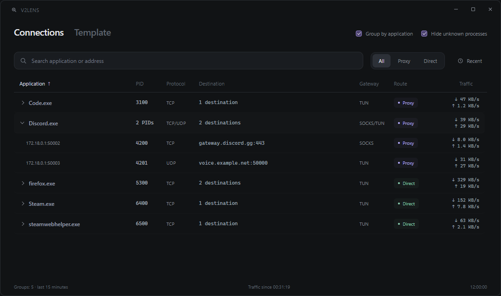

<p align="center"></p>
<h1 align="center">V2Lens</h1>
<p align="center"><b>English</b> · <a href="docs/README.ru.md">Русский</a></p>
<p align="center">Minimal Xray connections and v2rayN template editor for Windows.</p>

**[Download for Windows x64](https://github.com/greeeenie/v2lens/releases/latest)**



### Get started

1. Put **V2Lens.exe next to v2rayN.exe** and start both apps.
2. Accept the administrator prompt, so V2Lens can reload an elevated v2rayN client.
3. Enable Xray **access logging to a file** in v2rayN to populate Connections.

**Requires:** Windows 10/11 x64 and [WebView2 Runtime](https://developer.microsoft.com/en-us/microsoft-edge/webview2/). Tested with v2rayN **7.25.6** / Xray **26.9.9**. No Python or Node.js installation needed for the EXE.

### What it does

- **Connections:** application → connections with PIDs, protocol, destination, speed, **Gateway (TUN / SOCKS)** and **Route (Proxy / Direct)**. Search, sort and group by application; no intermediate PID groups.
- **[Template editor](docs/screenshots/template.png):** separate **TUN / Without TUN** templates, drafts, undo and persistent folds. JSON highlighting, Format, Expand all and context-aware **+** insertion. Save validates each template with the installed Xray.
- **Resizable window:** drag any edge or corner. Optional **Auto-reload v2rayN** reloads only when editing the active mode.
- **Portable:** local UI state in `V2Lens-data` beside the EXE; falls back to `%LOCALAPPDATA%\V2Lens` if needed. No servers, subscriptions or personal logs are shipped.

Template edits **Full Config Template → Xray** (`TunConfig` / `Config`), not routing profiles. Selecting a template does not toggle TUN. An empty field uses v2rayN defaults; no config is copied between modes. Auto-reload is off by default. Connections shows Xray's routing decisions; traffic bypassing Xray can be absent.

<details><summary>Build from source</summary>

Windows x64, Python 3.12, Node.js 22+, .NET Framework 4.x compiler and WebView2:

```powershell
python -m pip install -e ".[build]"
npm ci --prefix frontend
npm run build --prefix frontend
python -m unittest discover -s tests
node frontend/test.mjs
node frontend/connections.test.mjs
node frontend/modes.test.mjs
python scripts/build.py
```

Outputs are in `dist/`. `src/v2lens/` contains application code, `frontend/` the editor sources, `scripts/` build tools, `native/` the ETW helper, and `tests/` Python checks. Run sources with `python -m v2lens --v2ray-dir "D:\Apps\v2rayN"`. GitHub Actions tests/builds on push; a `vX.Y.Z` tag matching `pyproject.toml` publishes a release.

</details>

[MIT license](LICENSE) · [Changelog](CHANGELOG.md) · Built with [v2rayN](https://github.com/2dust/v2rayN), [Xray](https://github.com/XTLS/Xray-core), CodeMirror, pywebview and TraceEvent. Independent project; third-party notices are included in the ZIP.
