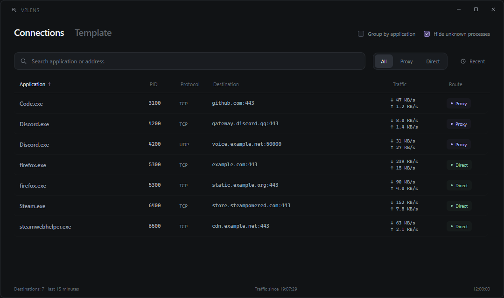
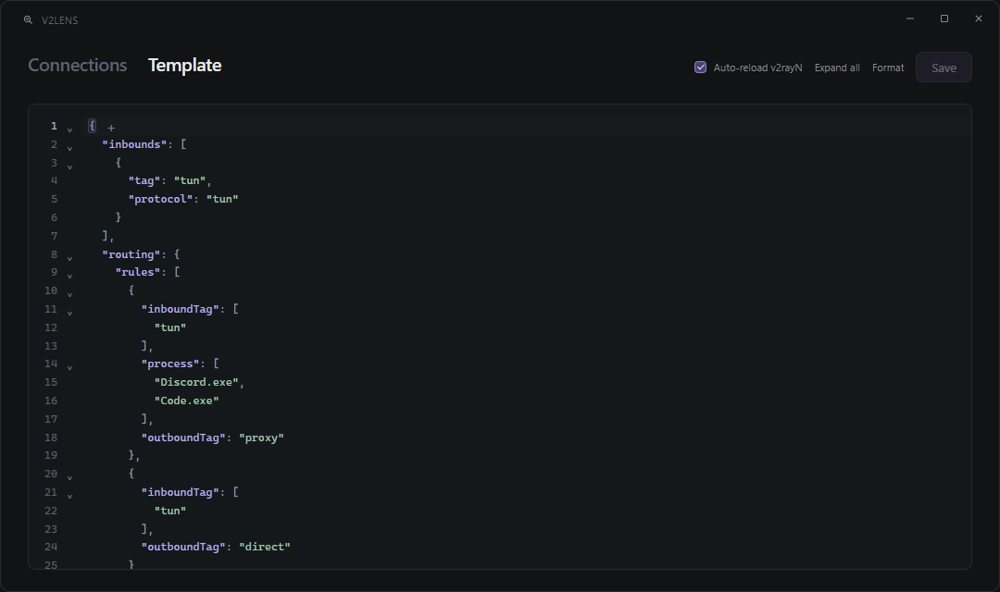

<p align="center"></p>
<h1 align="center">V2Lens</h1>
<p align="center">A minimal Xray connection viewer and v2rayN TUN template editor for Windows.</p>
<p align="center"><a href="https://github.com/greeeenie/v2lens/releases/latest">Download for Windows x64</a> · <a href="LICENSE">MIT license</a></p>

V2Lens показывает, как Xray маршрутизирует соединения приложений, и позволяет удобно редактировать полный TUN-шаблон v2rayN. Тёмный интерфейс, две вкладки, без отдельного дашборда.



На скриншотах — демонстрационные данные.

## Установка

1. Скачай **V2Lens.exe** или **V2Lens-portable.zip** из [Releases](https://github.com/greeeenie/v2lens/releases/latest).
2. Положи **V2Lens.exe рядом с v2rayN.exe**, в основную папку клиента.
3. Запусти v2rayN, затем V2Lens. Подтверди запрос администратора Windows — права нужны для команды Reload повышенному клиенту и подсчёта трафика через ETW.

Python и Node.js устанавливать не нужно. V2Lens использует серверы и конфигурацию уже настроенного v2rayN; собственный прокси-сервер не устанавливает.

**Совместимость:** Windows 10/11 x64, v2rayN с Xray. Проверено с **v2rayN 7.25.6 / Xray 26.9.9**. Для интерфейса требуется [Microsoft Edge WebView2 Runtime](https://developer.microsoft.com/en-us/microsoft-edge/webview2/). Другие ядра и все версии v2rayN не проверены.

## Connections

- Приложение, PID, протокол, адрес назначения и маршрут **Proxy / Direct / Blocked**.
- Поиск, фильтры, сортировка и группировка по имени приложения с раскрытием процессов и соединений.
- Скорость отправки и загрузки, если соединение удалось точно сопоставить с ETW-счётчиками.
- Скрытие неизвестных процессов и служебных DNS-маршрутов.

В v2rayN должна быть включена **запись access-журнала Xray в файл**. Если файла нет, V2Lens покажет подсказку. Он читает путь из текущего `binConfigs/config.json` или последний `guiLogs/Vaccess_*.txt`.

Маршрут берётся из журнала Xray, а не угадывается по адресу сервера. Это **не системный перехватчик всего трафика**: соединения в обход Xray могут отсутствовать. Записанный маршрут не доказывает успешную доставку данных. Короткие и старые соединения могут остаться без имени процесса; тогда отображаются доступные адреса и PID.

## Template



Редактор работает с **Full Config Template Setting → Xray → xray tun config template json** в локальной базе v2rayN. Создай и включи этот шаблон в самом v2rayN перед использованием. Редактор не подменяет обычный Routing Setting; при включённом полном шаблоне маршрутизация задаётся в нём.

| Действие | Как работает |
| --- | --- |
| **Save / Ctrl+S** | Проверяет JSON и конфигурацию штатным Xray, затем сохраняет шаблон. |
| **Auto-reload v2rayN** | После успешного сохранения вызывает штатный F5 Reload и проверяет смену процесса Xray. Галочка запоминается; по умолчанию выключена. |
| **Format / Ctrl+Shift+F** | Выравнивает JSON, сохраняя исходные строковые и числовые литералы. |
| **Expand all** | Разворачивает все блоки. Свёрнутость запоминается между запусками. |
| **+ в конце строки** | Добавляет поле/элемент с запятыми. В массиве строк вставляет `""` и ставит каретку между кавычками; тип берётся по соседнему элементу. |

При параллельном изменении шаблона другим редактором V2Lens сохраняет черновик и предлагает **Load latest**. Отключённый шаблон он сам не включает. Если сохранение прошло, а Reload не подтвердился, об этом выводится отдельное сообщение; сохранённый текст остаётся в базе.

## Локальные данные

Настройки, свёрнутые блоки и диагностические данные хранятся в **V2Lens-data** рядом с EXE. Если папка недоступна для записи — в `%LOCALAPPDATA%\V2Lens`. Для переноса настроек скопируй папку вместе с EXE. В репозиторий и дистрибутив не входят пользовательские базы, подписки и журналы.

Можно явно выбрать установку клиента:

```text
V2Lens.exe --v2ray-dir "D:\Apps\v2rayN"
```

## Сборка из исходников

На Windows x64 нужны **Python 3.12**, **Node.js 22+**, .NET Framework 4.x с `csc.exe` и WebView2. Интернет нужен для первоначальной установки зависимостей; готовый редактор работает локально.

```powershell
python -m pip install -r requirements-build.txt
npm ci --prefix editor
npm run build --prefix editor
python -m unittest discover -p "test_*.py"
node editor/test.mjs
python build_exe.py
```

Результат: `dist/V2Lens.exe`, `dist/V2Lens-portable.zip`, `dist/SHA256SUMS.txt`. Сборщик загружает закреплённые NuGet-пакеты ETW и проверяет SHA-256, компилирует помощник и включает статические ресурсы. Тест браузерного редактора использует установленный Microsoft Edge.

Запуск исходников: `python viewer.py --v2ray-dir "D:\Apps\v2rayN"`. Для Reload v2rayN, запущенного от администратора, исходный Python-процесс тоже должен иметь эти права.

GitHub Actions проверяет и собирает проект при push/PR. Тег `vX.Y.Z`, совпадающий с `VERSION`, публикует EXE, ZIP и контрольные суммы в Releases. Процесс: изменить `VERSION` и `CHANGELOG.md`, отправить коммит, создать и отправить тег.

## Проекты и лицензии

[v2rayN](https://github.com/2dust/v2rayN) · [Xray](https://github.com/XTLS/Xray-core) · [CodeMirror](https://codemirror.net/) · [pywebview](https://pywebview.flowrl.com/) · [psutil](https://github.com/giampaolo/psutil) · [TraceEvent](https://github.com/microsoft/perfview)

Исходники V2Lens — [MIT](LICENSE). Лицензии сторонних компонентов находятся в `licenses/` и `json-editor.LICENSE.txt` и входят в переносимый архив. V2Lens — самостоятельный проект, не официальный клиент разработчиков v2rayN или Xray.
